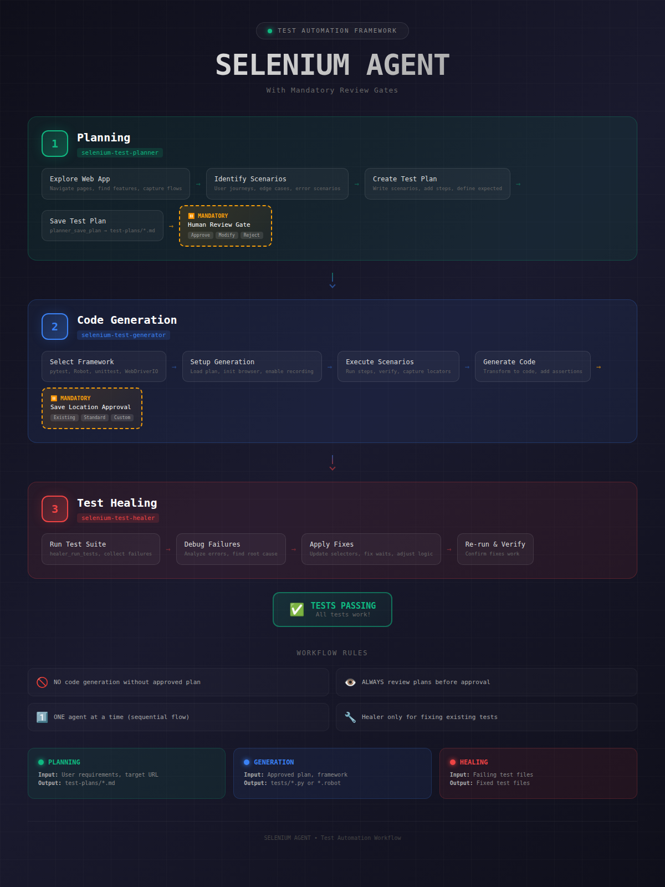

# Selenium AI Agent

[](https://www.npmjs.com/package/selenium-ai-agent)
[](https://opensource.org/licenses/MIT)
[](https://www.youtube.com/@ralphvanderhorst5193/videos)
[](https://www.selenium.dev/documentation/grid/)

**AI test agents for Selenium: plan, review, generate and heal tests from a prompt, with reports linked to the test plan you approved.**

Selenium AI Agent is an open-source MCP server that brings Playwright-style AI test agents (planner, generator, healer) to Selenium: you approve the test plan before any test is written, tests are generated and self-healed in a real browser (also in parallel on Selenium Grid), and every JUnit or Allure result links back to its plan scenario. It works in Claude Code, Claude Desktop, VS Code (GitHub Copilot), Cursor, JetBrains IDEs and other MCP clients. On npm: `selenium-ai-agent`.

- **Test agents:** a planner explores your app and writes a structured test plan, a generator turns it into tests checked live in the browser, and a healer runs and repairs them.
- **You approve the plan first:** the plan opens as a review page in your browser; tests are only generated from a plan you approved.
- **Reports testers can read:** JUnit XML and Allure, with every result linked to its plan scenario: which scenario failed, at which step, with a screenshot.
- **Python + pytest by default**, and any other language on request: Java, C#, JavaScript/TypeScript, WebdriverIO, Robot Framework.
- **Works in your AI client:** Claude Code, Claude Desktop, VS Code (GitHub Copilot) and Cursor.
- **Built in Node.js:** run it with `npx -y selenium-ai-agent`; the matching browser driver is downloaded for you.
- **Scales with Selenium Grid:** parallel sessions on Chrome, Firefox and Edge.

[](https://insiders.vscode.dev/redirect?url=vscode%3Amcp%2Finstall%3F%257B%2522name%2522%253A%2522selenium-ai-agent%2522%252C%2522command%2522%253A%2522npx%2522%252C%2522args%2522%253A%255B%2522selenium-ai-agent%2522%255D%257D) [](https://insiders.vscode.dev/redirect?url=vscode-insiders%3Amcp%2Finstall%3F%257B%2522name%2522%253A%2522selenium-ai-agent%2522%252C%2522command%2522%253A%2522npx%2522%252C%2522args%2522%253A%255B%2522selenium-ai-agent%2522%255D%257D) [](https://cursor.com/en/install-mcp?name=selenium-ai-agent&config=eyJjb21tYW5kIjoibnB4IiwiYXJncyI6WyJzZWxlbml1bS1haS1hZ2VudCJdfQ%3D%3D)

<p align="center">
  
</p>

## Contents

- [Video tutorials](#video-tutorials)
- [Quick start](#quick-start)
- [How the test agents work](#how-the-test-agents-work)
- [Example prompts](#example-prompts)
- [Languages and frameworks](#languages-and-frameworks)
- [Parallel testing with Selenium Grid](#parallel-testing-with-selenium-grid)
- [Configuration](#configuration)
- [Tools](#tools)
- [Documentation](#documentation)
- [Contributing](#contributing)

## Video Tutorials

Short demos with a voice-over, [on YouTube](https://www.youtube.com/@ralphvanderhorst5193/videos):

| Planner: from one prompt to a test plan | Generator: from the plan to running pytest tests |
|:---:|:---:|
| [](https://www.youtube.com/watch?v=M8JM35nA9hY) | [](https://www.youtube.com/watch?v=cPUBRsP9MSo) |
| The planner explores a web shop and writes `specs/shopping-cart-and-checkout.md`: 2 suites, 8 tests, 16 steps. (2:09) | The generator writes one pytest file per plan test, runs them, and shows the HTML report, including a real bug it found. (1:44) |

More tutorials: [youtube.com/@ralphvanderhorst5193](https://www.youtube.com/@ralphvanderhorst5193/videos) · Practice site used in the demos: [practiceautomatedtesting.com](https://practiceautomatedtesting.com)

## Quick Start

You need **Node.js 20+** and a browser (Chrome, Firefox or Edge).

### 1. Add the server to your AI client

**Claude Code:**

```bash
claude mcp add selenium-ai-agent -- npx -y selenium-ai-agent
```

**Claude Desktop, Cursor, Windsurf or Junie in IntelliJ IDEA / PyCharm** (writes the config for you):

```bash
npx selenium-ai-agent install claude-desktop   # or: cursor, windsurf, junie
```

Where your test plans, tests and reports go:

- **Claude Code, VS Code, Cursor** with the agents installed in your project (`init-agents`, step 2): in the project itself, with plans in its `specs/`.
- **Claude Desktop** and other clients with one global config: in `~/selenium-ai-agent`, since they aren't tied to a project. Add `--output-dir=<folder>` to use another folder.

<details>
<summary>Manual configuration</summary>

**Claude Desktop** (`~/Library/Application Support/Claude/claude_desktop_config.json`) and **Cursor** (`.cursor/mcp.json`):

```json
{
  "mcpServers": {
    "selenium-ai-agent": {
      "command": "npx",
      "args": ["-y", "selenium-ai-agent"]
    }
  }
}
```

**VS Code / GitHub Copilot** (`.vscode/mcp.json`):

```json
{
  "servers": {
    "selenium-ai-agent": {
      "command": "npx",
      "args": ["-y", "selenium-ai-agent"],
      "type": "stdio"
    }
  }
}
```

**IntelliJ IDEA / PyCharm with AI Assistant**: *Settings → Tools → AI Assistant → Model Context Protocol (MCP) → Add → As JSON*, and paste the `mcpServers` JSON above. With GitHub Copilot in a JetBrains IDE: *Settings → Tools → GitHub Copilot → Model Context Protocol (MCP) → Configure*, and add the `servers` JSON above.

See [MCP Client Setup](docs/MCP_CLIENT_SETUP.md) and the [package README](selenium-mcp-server/README.md#jetbrains-ides-intellij-idea-pycharm-webstorm-) for all clients, including Cline and Windsurf.

</details>

### 2. Install the test agents in your project (optional)

```bash
npx selenium-ai-agent init-agents --loop=claude    # Claude Code subagents
npx selenium-ai-agent init-agents --loop=vscode    # VS Code chat modes
npx selenium-ai-agent init-agents --loop=copilot   # GitHub Copilot coding agent
npx selenium-ai-agent init-agents --loop=cursor    # Cursor rules
```

Add `--with-rules` to also put Selenium's [rules for AI agents](https://www.selenium.dev/documentation/ai_agents/) in your project's `CLAUDE.md`, `.cursor/rules/selenium.mdc` or `.github/copilot-instructions.md`, so every AI tool you use writes modern Selenium code.

### 3. Ask for tests

```text
Explore the shopping section of https://practiceautomatedtesting.com and create a test plan
for the shopping cart and checkout.
```

Then:

```text
Generate Selenium tests from specs/shopping-cart-and-checkout.md, run them, and show me the test report.
```

Something not starting? Run `npx selenium-ai-agent doctor`.

## How the Test Agents Work

```text
┌─────────────────┐    ┌─────────────┐    ┌─────────────┐    ┌────────────┐
│    Analyzer     │───▶│   Planner   │───▶│  Generator  │───▶│   Healer   │
│  (risk profile) │    │ (test plan) │    │ (test code) │    │(fix tests) │
└─────────────────┘    └─────────────┘    └─────────────┘    └────────────┘
                             │                  │
                        human review       human review
```

| Agent | What it does | Output |
|-------|--------------|--------|
| **Analyzer** (optional) | Scans the product and builds a risk profile, so testing starts where it matters most. | Risk profile |
| **Planner** | Explores the app in a real browser, takes an inventory of every page and pop-up, and writes a plan in the same structure as Playwright's planner: suites → tests → steps with `expect`. It adds the elements found (with stable locators) and the gaps. | `specs/<feature>.md` |
| **Generator** | Writes one test file per plan test, with an assertion for every `expect`, after checking each value live in the browser. Sets up the project (for Python: a virtual environment with Selenium and pytest) if needed. | Test files, a run command |
| **Healer** | Runs the tests, debugs failures, inspects the page and fixes broken locators or waits, then runs them again. | Passing tests, or a clear bug report |
| **Migrator** | Upgrades an existing suite to current Selenium 4: scans it for Selenium 3 patterns, sleeps and mixed waits (`selenium_rules_check`), runs it as a baseline, rewrites one file at a time and proves each still passes. | Migrated tests, before/after results per file |

The generator and healer follow [Selenium's guide for AI agents](https://www.selenium.dev/documentation/ai_agents/) (and [WebdriverIO's](https://webdriver.io/docs/ai-agents) for WebdriverIO): they read the current docs from `llms.txt` with `get_selenium_docs`, and refuse to write a test with a sleep, a driver path, `DesiredCapabilities` or a Selenium 3 API.

You review the plan before code is generated, and the code before it is committed. The plan review is on by default: every plan is saved as a **draft**, and the generator refuses a draft plan. The planner opens it as a **review page** in your browser: every test with its steps and expected results, a comment box per test, and **Approve plan** / **Request changes** buttons that write your decision into the plan. Requested changes go back to the planner. You can also review without the AI: `npx selenium-ai-agent review` in your project opens all plans in your browser. An **overview of all plans** shows each plan's review status, its tests, the test files generated from it and the last run. Need speed instead? `SELENIUM_MCP_PLAN_REVIEW=off` (or `--no-plan-review`) turns the check off. The [Agent Workflow](docs/AGENT_WORKFLOW.md) guide covers each stage in detail.

### Test reports, linked to the approved plan

Selenium has no reporting of its own, so every generated suite writes one: **JUnit XML** by default (read by every CI system, ReportPortal and Allure), and **Allure** when you ask for it or your project already uses it. `healer_run_tests` reads the results and links every test to the plan scenario it implements:

- `reports/junit-plans.xml`: the JUnit results with the plan, scenario and review status as properties of each test, for your CI or ReportPortal
- Allure results get the plan as **epic**, the suite as **feature** and the scenario as **story**, so the report shows your approved plan with a result per scenario. Each test is named after its scenario, its description is the steps and expected results you approved, every plan step is a step in the report (in the plan's words), and a failing test gets a screenshot
- the plan's review page shows the latest result per scenario (✓ passed, ✗ failed with the message, not run yet), and the overview of all plans shows "2 of 3 scenarios passed"
- tests with no approved plan behind them are counted, so they stand out

## Example Prompts

| Goal | Prompt |
|------|--------|
| Try it | `Go to https://practiceautomatedtesting.com and take a screenshot` |
| Test plan | `Explore the checkout flow at https://practiceautomatedtesting.com and create a test plan` |
| Python tests (default) | `Generate tests from specs/checkout-flow.md` |
| Another language | `Generate WebdriverIO tests for the login flow at https://practiceautomatedtesting.com` |
| Fix failures | `Run my tests and fix any failures` |
| Allure report | `Generate the tests from specs/checkout-flow.md with an Allure report` |
| Parallel (Grid) | `Explore https://practiceautomatedtesting.com in parallel using 4 browsers` |

[Example Chats](docs/EXAMPLE_CHATS.md) shows each prompt with the tools it calls and the result, including generated code for pytest, WebdriverIO, Playwright and Robot Framework.

## Languages and Frameworks

If you don't name one, the generator uses **your project's own stack**: Java with JUnit 5 or TestNG (from `pom.xml` or `build.gradle`), Python with pytest or unittest (`requirements.txt`, `pyproject.toml`, `pytest.ini`), C# with NUnit, xUnit or MSTest (`*.csproj`), JavaScript/TypeScript (`package.json`) or Robot Framework (`*.robot`). In an empty project it uses **Python with pytest**.

| Language | Frameworks (`framework` value) |
|----------|-------------------------------|
| Python | pytest (`selenium-python-pytest`, default), unittest (`selenium-python-unittest`), Playwright (`playwright-python`), Robot Framework (`robot-framework`) |
| Java | Maven (`selenium-java-maven`), Gradle (`selenium-java-gradle`) |
| C# | NUnit (`selenium-csharp-nunit`), MSTest (`selenium-csharp-mstest`), xUnit (`selenium-csharp-xunit`) |
| JavaScript / TypeScript | WebdriverIO (`webdriverio-ts`, `webdriverio-js`), Mocha (`selenium-js-mocha`), Jest (`selenium-js-jest`), Playwright (`playwright-js`) |

Conventions per framework are in [Framework Standards](docs/FRAMEWORK_STANDARDS.md).

### Sample projects

Ready-made projects to try the agents on, each with a test plan, a section left for the generator to write, and an old Selenium 3 suite for the migrator:

| Sample | Stack |
|---|---|
| [`examples/java-junit5`](examples/java-junit5) | Java 17+, Maven, Selenium 4, JUnit 5, page objects |
| [`examples/csharp-nunit`](examples/csharp-nunit) | .NET 8+, Selenium 4, NUnit, page objects |

## Parallel Testing with Selenium Grid

Everything above works with a local browser. Selenium Grid adds parallel sessions: explore or test many parts of an application at once, across Chrome, Firefox and Edge.

| | Playwright MCP | Selenium AI Agent |
|---|---|---|
| **Parallelism** | Single browser, shared context | Many sessions on Grid nodes |
| **Scaling** | Limited by one browser | Add nodes as needed |
| **Isolation** | Shared state between clients | Full isolation per session |
| **Multi-browser** | One at a time | Chrome, Firefox and Edge at the same time |

### 1. Start the Grid

```bash
git clone https://github.com/learn-automated-testing/selenium-ai-agent.git
cd selenium-ai-agent/selenium-grid
docker-compose up -d          # Grid console: http://localhost:4444

docker-compose up -d --scale chrome-node=10   # scale up any time
```

The included `docker-compose.yml` starts a hub, 4 Chrome nodes and 1 Firefox node.

### 2. Point the server at it

```json
{
  "mcpServers": {
    "selenium-ai-agent": {
      "command": "npx",
      "args": ["-y", "selenium-ai-agent"],
      "env": { "SELENIUM_GRID_URL": "http://localhost:4444" }
    }
  }
}
```

### 3. Explore in parallel

```text
Explore https://practiceautomatedtesting.com in parallel: the homepage, products, cart and checkout at the same time.
```

`parallel_explore` starts one session per section, `exploration_merge` combines the results into one site map, and `planner_generate_plan` writes the test plan.

## Configuration

| Variable | Default | Description |
|----------|---------|-------------|
| `SELENIUM_GRID_URL` | — | Grid hub URL; enables the parallel tools |
| `SELENIUM_HEADLESS` | `false` | Run the browser headless |
| `SELENIUM_MCP_TOOLSETS` | `all` | Tool groups to load, e.g. `core,generator,healer` |
| `SELENIUM_MCP_PLAN_REVIEW` | `required` | `off` lets the generator use plans nobody approved, for speed (flag: `--no-plan-review`) |
| `SELENIUM_MCP_SPECS_DIR` | `specs` | Folder for the test plans, e.g. `test-plans` when your project already uses `specs/` (flag: `--specs-dir=`) |
| `SELENIUM_STEALTH` | `false` | Mask basic automation flags (does not get past advanced bot protection) |
| `SE_AVOID_STATS` | — | `true` disables Selenium usage statistics |

All variables, CLI flags, driver and proxy setup, and troubleshooting are in the [package README](selenium-mcp-server/README.md).

## Tools

79 tools, 65 without Grid.

<details>
<summary>Show all tools</summary>

**Test agents**

| Agent | Tools |
|-------|-------|
| **Planner** | `planner_setup_page`, `planner_explore_page`, `planner_save_plan`, `planner_review_plan`, `planner_approve_plan` |
| **Generator** | `generator_setup_page`, `generator_read_log`, `generator_write_test`, `generator_write_seed`, `generator_save_spec`, `generator_read_spec` |
| **Healer** | `healer_run_tests`, `healer_debug_test`, `healer_fix_test`, `healer_inspect_page`, `browser_generate_locator`, `selenium_rules_check` |
| **Analyzer** | `analyzer_setup`, `analyzer_import_context`, `analyzer_scan_product`, `analyzer_build_risk_profile`, `analyzer_save_profile`, `analyzer_generate_documentation` |

**Browser**

| Group | Tools |
|-------|-------|
| Navigation | `navigate_to` · `go_back` · `go_forward` · `refresh_page` |
| Page analysis | `capture_page` · `take_screenshot` |
| Elements | `click_element` · `hover_element` · `select_option` · `drag_drop` |
| Input | `input_text` · `key_press` · `file_upload` |
| Mouse | `mouse_move` · `mouse_click` · `mouse_drag` |
| Verification | `verify_element_visible` · `verify_text_visible` · `verify_value` · `verify_list_visible` |
| Browser | `wait_for` · `execute_javascript` · `dialog_handle` · `console_logs` · `network_monitor` · `resize_window` · `pdf_generate` |
| Tabs | `tab_list` · `tab_select` · `tab_new` · `tab_close` |
| Session | `close_browser` · `reset_session` · `set_stealth_mode` |
| Recording | `start_recording` · `stop_recording` · `recording_status` · `clear_recording` |
| Batch | `batch_execute` |
| Docs | `get_selenium_docs` (current Selenium / WebdriverIO docs from their `llms.txt`) |

**Grid and parallel execution**

| Tool | Description |
|------|-------------|
| `grid_status` | Check Grid health, nodes and capacity |
| `grid_start` / `grid_stop` | Start or stop the Docker Compose Grid |
| `grid_scale` | Scale Grid nodes up or down |
| `session_create` / `session_select` / `session_list` | Create, switch and list browser sessions on the Grid |
| `session_destroy` / `session_destroy_all` | Clean up one or all sessions |
| `parallel_explore` | Explore several URLs at the same time |
| `parallel_execute` | Run tasks in parallel across sessions |
| `exploration_merge` / `exploration_diff` | Combine or compare exploration results |
| `planner_generate_plan` | Generate a test plan from an exploration |

</details>

## Documentation

- [Video tutorials](https://www.youtube.com/@ralphvanderhorst5193/videos): planner and generator demos on YouTube
- [MCP Client Setup](docs/MCP_CLIENT_SETUP.md): Claude Code, Claude Desktop, Cursor, Copilot, Cline, Windsurf
- [Example Chats](docs/EXAMPLE_CHATS.md): prompts with the tools they call and the results
- [Agent Workflow](docs/AGENT_WORKFLOW.md): the end-to-end testing pipeline
- [Framework Standards](docs/FRAMEWORK_STANDARDS.md): code generation conventions
- [Package README](selenium-mcp-server/README.md): all tools, options and troubleshooting

<details>
<summary>Project structure</summary>

```text
selenium-ai-agent/
├── selenium-mcp-server/     # TypeScript MCP server (npm: selenium-ai-agent)
│   └── src/
│       ├── server.ts        # MCP protocol handler
│       ├── context.ts       # Browser session management
│       ├── grid/            # Selenium Grid integration
│       └── tools/           # navigation, elements, grid, agents, analyzer
├── selenium-grid/
│   └── docker-compose.yml   # Selenium Grid setup
├── agents/                  # Agent prompt definitions
└── docs/                    # Guides and diagrams
```

</details>

## Contributing

Contributions are welcome:

1. Fork the repository
2. Create a feature branch (`git checkout -b feature/amazing-feature`)
3. Commit your changes (`git commit -m 'Add amazing feature'`)
4. Push the branch (`git push origin feature/amazing-feature`)
5. Open a pull request

## License

MIT — see [LICENSE](LICENSE).

## Acknowledgments

- [Selenium](https://www.selenium.dev/): the browser automation framework
- [Model Context Protocol](https://modelcontextprotocol.io/): the AI agent communication standard
- [Anthropic](https://www.anthropic.com/): for Claude and the MCP specification
- [Playwright](https://playwright.dev/): whose test agents inspired the planner, generator and healer

---

<p align="center">
  <b>If this project helps you, please give it a star!</b><br>
  <a href="https://github.com/learn-automated-testing/selenium-ai-agent">Star on GitHub</a>
</p>
